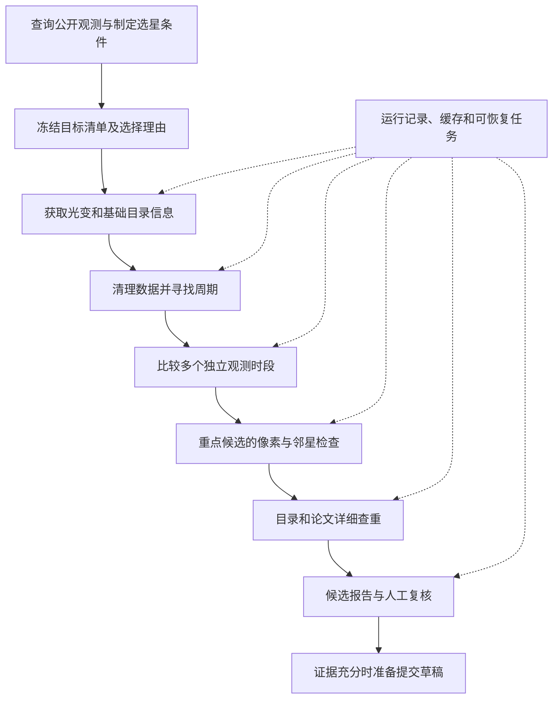

# 系统框架与执行计划

更新日期：2026-11-10。状态：实现前设计。当前可运行代码仍是前期三个探索脚本；本文中的模块、命令和批量流程是接下来的实现目标。

## 第一版要交付什么

输入一份目标清单或选星配置，程序自动获取公开光变数据，寻找周期、比较观测时段、检查邻星干扰并辅助查重。输出可浏览的候选报告，以及每个判断对应的数据、图表和理由。

第一版先用历史案例验证，再完成一批约 100 个新目标的筛选和少量重点对象的完整复核。后续扩大到约 1,000 个目标。成功标准是流程可靠、结果可以检查，不把“必须发现新变星”作为软件验收标准。

用户应能从报告中理解：这颗星哪里有意思、现有证据支持什么、还缺什么、为什么保留或淘汰。算法运行失败和目录查询失败必须显式显示。

## 整体流程



基础目录检查在早期进行，节省对已知对象的分析成本；重点候选再做完整的文献检索。为校验方法而纳入的已知变星会单独标记，不计入新目标的发现统计。

## 模块和职责

| 模块 | 工作 | 主要产物 |
|---|---|---|
| 目标选择 | 查询 MAST 可用产品，检查多时段覆盖、亮度和拥挤程度，冻结样本 | 目标清单、筛选条件、保留及排除原因 |
| 数据获取 | 下载光变及必要的像素文件，分页、限速、重试，检查缓存完整性 | FITS、下载清单、SHA-256 |
| 光变准备 | 读取质量标记和时间标准，处理缺失与跳变，保留不同清理方案 | 原始与处理后曲线、处理参数 |
| 周期搜索 | Lomb–Scargle 初筛；针对食形信号补充 BLS；保留竞争周期 | 周期图、相位图、幅度及质量指标 |
| 多时段验证 | 单独分析各时段，检查周期及谐波关系，再考虑联合拟合 | 周期对照表、相位及形状比较 |
| 来源定位 | 检查目标像素、不同孔径、邻星位置、背景和质心变化 | 像素信号图、邻星表、定位结论 |
| 目录与文献 | 通过标识和坐标查询多个来源，记录每次查询是否完成 | 已知记录、引用和检索缺口 |
| 候选评估 | 汇总证据，标明通过、淘汰和待核实的原因 | 候选表、排除原因、人工复核入口 |
| 报告 | 生成本地 HTML、Markdown 摘要和机器可读结果 | 总览页、单星报告、CSV/JSON |

## 技术选择

使用 Python 3.12，数值分析以 NumPy、SciPy、Astropy 为主，图表使用 Matplotlib。优先使用成熟算法，保留数据清理、参数和结果记录。

第一版以命令行运行，输出可以在浏览器打开的静态 HTML 报告。科学图表保存为 PNG，候选表可筛选或排序。先实现这些直接服务于分析的功能；独立网页应用属于后续需求。

配置用 TOML。任务状态用 SQLite，下载、图表和报告用普通文件保存。SQLite 由主进程写入，避免多个下载或分析任务竞争写库。网络下载可有限并发，计算量上来后再按实际耗时决定是否使用进程池。

Git 根目录保持在工作空间最外层；`repo/` 内组织 Python 工程，不再初始化嵌套仓库。

```text
variable-star-discovery/
├── doc/
└── repo/
    ├── pyproject.toml
    ├── configs/
    │   ├── historical.toml
    │   └── pilot.toml
    ├── src/vstar/
    │   ├── cli.py
    │   ├── models.py
    │   ├── pipeline.py
    │   ├── storage.py
    │   ├── sources/
    │   ├── photometry/
    │   ├── periods/
    │   ├── validation/
    │   ├── catalogs/
    │   └── reports/
    ├── tests/
    ├── experiments/2026-11-09-pilot/
    ├── data/
    └── runs/<run_id>/
```

上面的新增目录尚未创建。历史实验作为固定参照保留，新一轮分析写入单独运行目录。

## 如何保证可恢复和可追溯

每次运行保存 `run_id`、配置摘要、代码版本、输入数据版本和随机种子。任务按目标、观测区和分析阶段划分；一次中断只需要恢复未完成或失败的部分。

任务状态区分等待、运行、成功、失败和跳过，并带有原因。下载先写临时文件，通过完整性检查再确认完成；同一个产品可以复用，变更处理参数则生成新的结果。

每份报告应能追溯到具体观测文件和处理版本。原始输入、处理后数据和汇总解释分开保存；新算法的结果不覆盖历史证据。

观测时间会保留数据原有的零点和时间标准，例如 BJD/TDB 等 FITS 元数据。不会把 MAST 检索接口中的时间字段直接当成相位计算的参考历元。

当前已提交的 38 个 FITS 保持在仓库中。扩大样本时需要按实际体积确定新增原始数据的版本存储方式；完整数据来源、校验值和候选证据始终保留，不将丢失的原始数据伪装成可复现结果。

## 候选结论如何表达

程序分别记录以下证据，不将其压缩成一个所谓“发现概率”。

| 判断 | 可以出现的结论 |
|---|---|
| 周期信号 | 明确、弱、不同方法不一致、无法分析 |
| 多时段重复性 | 支持、部分支持、不一致、没有足够观测 |
| 信号来源 | 支持来自目标、疑似邻星污染、分辨能力不足 |
| 新颖性 | 找到先前报告、存在待追溯线索、已查询来源未发现记录、查询未完成 |

汇总状态可以是 `known_variable`、`likely_contaminated`、`periodic_candidate`、`inconclusive` 或 `ready_for_review`。最后一个状态只表示资料可供人工复核，不是自动宣布发现，也不是 VSX 接受。

目录接口正常返回零条结果，与超时、权限不足、解析失败是不同状态。ADS 等服务若需要凭据，记录接入条件，并允许人工补充可引用的文献证据；不能用“跳过服务”完成查重。

坐标近邻需要核实对象身份、自行和历元，不能把固定 10 角秒内的任意条目都认作目标本身。某个网站上的训练集或候选记录要继续追溯其原始来源。

## 分析质量怎样验证

历史三个对象用于检查特定失败模式：

- **TIC 259238257**：应识别约 0.2602 天信号与附近已知食双星有关，不将其认作目标的新发现。
- **TIC 458747716**：应重现不同观测区约 2.3 天的变化，同时保留周期并不完全一致和首次发现资格待查的结论。
- **TIC 10604247**：应保留不同观测区周期不一致的结果，不以最漂亮的一段替代全部证据。

这三颗不能覆盖所有算法表现。后续还会加入身份和周期明确的已知变星作为正例，并把已知周期、幅度的人工信号加入实际采样和噪声中，检查周期恢复、半周期误判和检测灵敏度。人工注入样本的参数和随机种子预先保存，避免按单个案例调整阈值。

噪声检验要考虑时间相关性，不能把独立白噪声假设下的显著性当成最终把握。报告会展示不同清理参数下的变化。跨观测区的周期一致性需要考虑误差和谐波，不能只按小数点后几位是否相同判断。

工程测试重点是损坏下载、查询失败、分页不完整、任务中断恢复和缓存误用。日常测试使用保存的公共样本或模拟响应；少量在线查询单独做集成验证，避免每次测试都依赖外网。

## 分阶段执行

| 阶段 | 实现内容 | 阶段验收 |
|---|---|---|
| A：整理工程并离线复现 | 建立 Python 工程、配置、数据模型和输出目录；拆出无导入副作用的读取与周期分析模块；导入历史清单 | 一个命令读取 33 个目标记录，重算有光变数据的 29 个目标，保留另外 4 个位置匹配预筛结果，生成初版总览；不触发新下载 |
| B：做实验证和恢复能力 | 加入下载管理、任务状态、多时段比较、像素诊断；补充正例、注入信号和失败模式测试 | 三个历史案例得到符合证据的处理；中断可恢复；坏文件和查询失败不被记为成功 |
| C：第一批新目标 | 查询实际可用产品，冻结约 100 个目标；运行周期初筛，选择少量对象做像素和完整查重 | 交付筛选数量、阶段状态、排除原因、完整报告和未解决事项 |
| D：逐步扩大 | 根据 C 的耗时、数据质量和有效候选情况，分批扩大到约 1,000 个目标 | 能复现运行，知道每批成本和候选淘汰原因；保持报告可审查 |
| E：发现资料 | 对证据充分的对象补齐周期误差、测光定义、分类、查重和来源定位，形成 VSX 草稿 | 每个字段都有来源；缺证据的对象继续保留为候选；正式提交按用户指示执行 |

阶段 A 的“复现”只检查保存数据和原有计算一致，不替原试验完成尚缺的科学核验。阶段 C 中失败的检索和未完成的复核如实列出，不计作通过。

第一批新目标优先选择有至少两个独立观测区、可直接获取光变产品的恒星，初始周期范围沿用 0.05–8 天并写入配置。最终范围还应结合采样间隔和时间覆盖调整。选择条件在看见分析结果前固定；实际可用目标不足时记录原因并调整下一批选择，而不是无记录地替换。

首轮建议最多四个并发下载任务，按 50–100 个目标分批，重点像素复核先控制在约 20 个对象以内。磁盘预算先设 20 GB，超限时停止新下载并保留进度。各项都是可调整的运行配置，不是科学判定阈值。

## 计划中的命令和交付

命令接口拟定如下，尚未实现：

```text
vstar run --config repo/configs/historical.toml --offline
vstar run --config repo/configs/pilot.toml --limit 100
vstar resume <run_id>
vstar inspect <tic_id> --run <run_id>
vstar report <run_id>
```

每次批量运行输出一张总览表、一份运行总结和每个重点候选的报告。单星报告展示对象身份、数据覆盖、周期图、相位图、多时段比较、邻星位置、目录与文献证据，以及当前结论和未解决问题。

LLM 负责协助编排工具、检索文献、解释图表和起草报告；数值计算由代码完成，关键判断引用可检查的证据。程序可以准备提交草稿，向 VSX 提交或联系研究人员仍按用户的明确指示执行。

下一项具体工作是阶段 A：把现有脚本整理成可安装的 Python 工程，并提供一次离线运行就能看到历史案例报告的入口。
