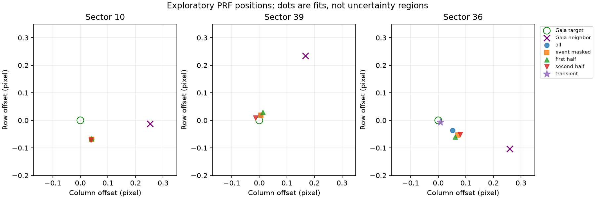

# TIC 302959739 追加核验

2026-11-22。新增 5 段光变后，TIC 302959739 仍值得优先核验：7 段原始 PDCSAP 中有 6 段检出约 0.4377 天、即 10.5 小时的重复变化；3 段像素诊断均更支持目标附近的来源。但第 36 区未通过原检测，7 段合并裁定仍为 `unresolved`，没有最终周期。近邻排除与首次发现资格尚未确认。

[完整图文报告](../repo/runs/tic-302959739-followup-2026-11-22/index.html)保留全部原始结果和事后诊断。[上一轮查重](24-candidate-catalog-followup.md)的另一颗候选 HD 43737A/B 本轮未继续分析。没有新增已确认变星，也没有对外投稿。

## 追加了哪些观测

最新 MAST 查询返回 7 个当前入口支持的标准、非 fast SPOC 观测区：10、11、12、36、37、38、39。复用原有 S10／S39，新增其余全部 5 段光变；新像素只取 S36，它是第二季最早的未用区、距已有 S39 最远。该选择在读取新增光变前记录于 `plan.json`，不按检测结果挑时段。这不表示该目标在所有其他产品或后续观测中都没有数据。

新增 FITS 共 6 份，包含 5 份光变和 1 份像素。MAST 查询原文、公开 S3 地址、下载字节数、ETag MD5、原始及压缩后的 SHA-256 均保存。原算法和门槛未改；新增光变的检测不接收参考周期，完成后再比较旧的约 0.4377 天结果。

## 原始检测结果

表中为各产品的优选光变周期；“弃选”表示检出了重复变化，但未选定唯一周期。SAP 与 PDCSAP 来自同一批像素，不能算两次独立观测。

| 观测区 | SAP／天 | PDCSAP／天 | 处理 |
|---|---:|---:|---|
| S10，复用 | 0.43773601 | 0.43773601 | 两产品均选定 |
| S11，新增 | 0.43761068 | 0.43762578 | 两产品均选定 |
| S12，新增 | 0.43778005 | 0.43768246 | 两产品检出，均因 competing_aliases 弃选 |
| S36，新增 | — | — | 两产品均未通过重复性检验 |
| S37，新增 | 0.43772717 | 0.43759643 | 两产品均选定 |
| S38，新增 | 0.43772324 | 0.43762117 | 两产品均选定 |
| S39，复用 | 6.56741300 | 0.43761719 | 两产品优选周期不同，原值保留 |

冻结的合并规则要求全部时段支持重复变化，因此两产品合并均为 `not_repeated_in_all_epochs`，最终裁定 `unresolved`、`selected_period_d = null`。保留候选是本轮人工跟进判断，不能说自动筛选已全通过。

从已有候选中取旧周期半倍、原倍和两倍各 1% 范围内预测改善最大的结果：约 0.2188 天的半周期在全部 7 段 PDCSAP 中不合格；约 0.8754 天的倍周期在同样 6 段中合格。倍周期可以容纳两个相似波形，不能单凭拟合区分真实自转周期或轨道周期。本轮没有给出物理分类、跨年相位连接、正式周期误差或历元。

## 第 36 区的强突增

S36 有一次快升后衰减的短时增亮。最高有效采样点为 BTJD 2296.910554，即 BJD_TDB − 2457000。相对各自整段中值，原始采样的 SAP 和 PDCSAP 峰值分别增加约 291% 和 478%。两产品受混光与上游校正影响不同，这些数值不是去混光后的本征耀发幅度，也不同于图上的 10 分钟分箱峰值。

原算法确实搜索到了约 0.4377 天，但交叉预测改善为负：SAP 约 −0.020、PDCSAP 约 −0.031，因此不合格。

另做事后诊断：按 PDCSAP 距中值超过 8 × 1.4826 × MAD，屏蔽 114／15,679 个有效采样点，两产品共用这个时间掩码。派生 FITS 明确带诊断标记，仅增加质量掩码，通量值不变。SAP 和 PDCSAP 均恢复并选定约 0.437909 天。该结果支持强突增是原检测失败的原因之一；剩余尾部和趋势仍可见，不能说已完整消除所有影响。

原始 S36 失败、7 段合并弃选及首次千星成绩全部保留。当前只能称为短时增亮或耀发候选，未确认具体物理性质。

## 周期信号更靠近目标

目标 Gaia DR3 `5221973868734158976` 的近邻 `5221973868731579136` 相距约 5.09 角秒，G 星等暗约 1.97。针对 S10、S39 和新增 S36，使用 Gaia J2016 位置及自行传播到观测时刻，以官方 TESS 像素响应模型拟合。

先对切片内 G ≤ 18.5 的 Gaia 星做非负光度拟合，加背景平面及共同坐标平移；再比较周期信号图的自由位置、固定目标位置和固定近邻位置。模型取自 MAST 的 S4 以后 PRF，插值器取自 `keatonb/TESS_PRF` 的固定版本，原文、MIT 许可、适配差异和模型文件均保存。

| 来源图 | 自由拟合位置距目标／像素 | 距近邻／像素 |
|---|---:|---:|
| S10，完整周期图 | 0.0795 | 0.2196 |
| S39，完整周期图 | 0.0194 | 0.2703 |
| S36，固定参考周期诊断 | 0.0632 | 0.2178 |
| S36，短时增亮差分图 | 0.0101 | 0.2691 |



全部拟合成功且未触搜索边界。以 1%、2%、5% 像素模型误差下限，以及排除目标周围 2 像素的 2% 设置做场图校准；去除突增、前半段、后半段的周期图也全部更靠近目标。固定目标的拟合残差损失低于固定近邻。不过，损失使用的是诊断权重，不是校准后的卡方或概率。

这些是支持目标来源的证据，仍不足以彻底排除近邻。场图有结构性残差，PRF 失配、颜色差异、场外源、缺失自行和多个变光源混合都可能影响亚像素位置。4 种权重设置只检查一部分敏感性；目标偏移不是定位误差，不能把 0.01 像素写成测量精度。S36 图采用事先已知周期，不能算新增独立检出。

本轮实际查看了 5 张新增区的双产品图、S36 屏蔽后图、3 张来源／残差图和位置对比图。S11、S12 中段有数据缺口；S12 散布较大；S37 折叠形状较清晰；S38 也有突增点但原检测通过。目测没有用于调门槛或改写结果。

## 复现与检查

- 5 项数值测试通过，覆盖亚像素坐标恢复、斜背景、共同平移、无信号不定位及瞬变掩码。
- 官方 PRF 的目标／近邻注入共 6 项恢复检查通过；同模型生成和恢复只验证实现，不校准真实天空误差。
- 5 段新光变重新计算后，全部产品结果和原始合并裁定与首次保存一致。
- 增加输入身份、时间标准检查后，3 段像素图、配准和拟合结果与首次计算一致。首次图与执行代码快照保留。
- 首次有标签千星基线的 7,041 个文件全部通过校验，检测源码指纹未变。

在项目根目录执行；重算必须给新目录，拒绝覆盖已有结果：

```bash
repo/.venv/bin/python repo/benchmarks/followup_302959739.py verify
repo/.venv/bin/python repo/benchmarks/followup_302959739.py rerun --output repo/runs/tic-302959739-reproduction
repo/.venv/bin/python repo/benchmarks/followup_302959739.py masked-diagnostic --output repo/runs/tic-302959739-mask-reproduction
repo/.venv/bin/python repo/benchmarks/localize_302959739.py --output repo/runs/tic-302959739-prf-reproduction
repo/.venv/bin/python repo/benchmarks/report_302959739.py
repo/.venv/bin/python -m pytest repo/tests/test_candidate_followup.py -q
repo/.venv/bin/python repo/benchmarks/report_labelled_baseline.py --verify-only
```

报告重建命令仅读保存结果，不联网或修改检测。原始输入、查询、模型、图、数字和哈希清单位于 [本轮运行目录](../repo/runs/tic-302959739-followup-2026-11-22/)。

后续重点是校准真实天空中的近邻排除能力，并查年轻星、自转和耀发研究中的先前记录。本轮没有扩展查重范围，不能将上一轮尚未查到报告升级为“此前未知”。另一颗 HD 43737A/B 仍需解决分量归属。

## 数据与模型来源

- [MAST TESS 数据](https://archive.stsci.edu/missions-and-data/tess)：新增标准 SPOC 光变和目标像素；精确 URI 与下载地址见 `acquisition.json`。
- [官方 TESS PRF 文件](https://archive.stsci.edu/missions/tess/models/prf_fitsfiles/start_s0004/)：具体相机、CCD、采样点及哈希见 `prf-reference/models.json`。
- [keatonb/TESS_PRF 固定版本](https://github.com/keatonb/TESS_PRF/tree/ae1d06c28429df4b136952dbe09d521a9f8eba10)：仅使用本地模型插值；保留 MIT 许可，移除未用依赖并禁止回退联网。
- [Gaia Archive](https://gea.esac.esa.int/archive/)：官方 TAP 查询 180 角秒范围，返回 276 行；源编号保留为字符串，原查询及返回内容保存在 `gaia-field.json`。
